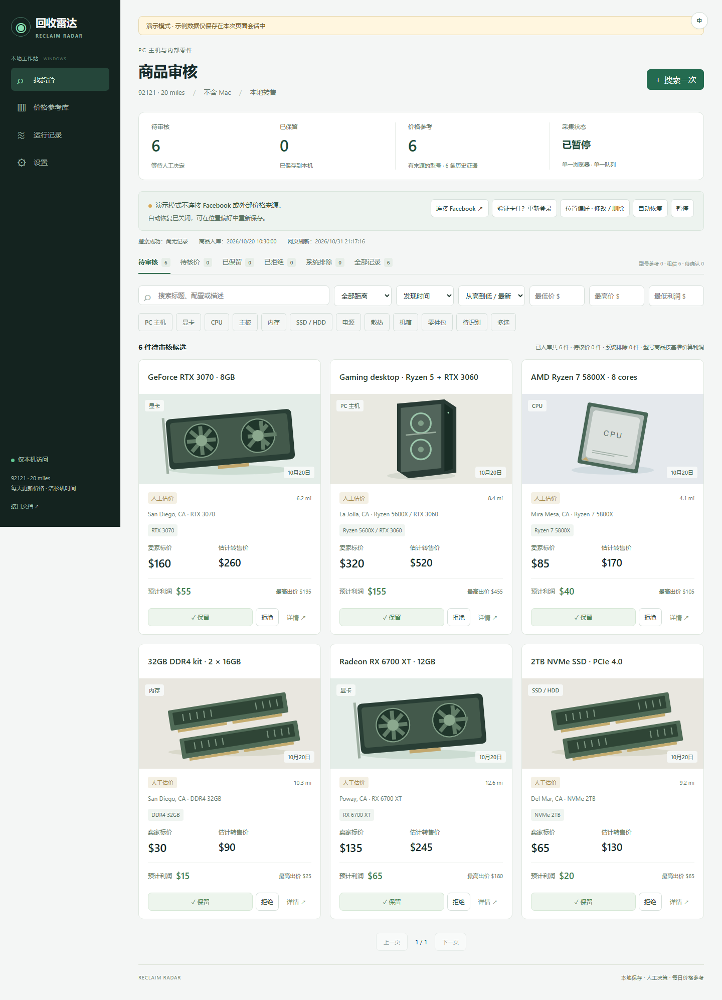
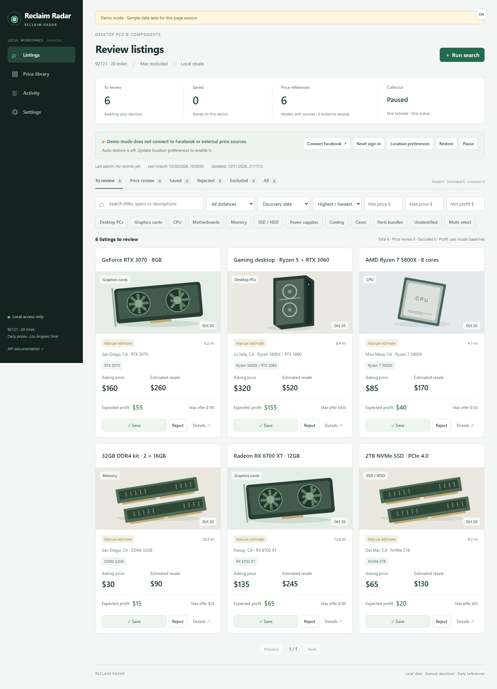
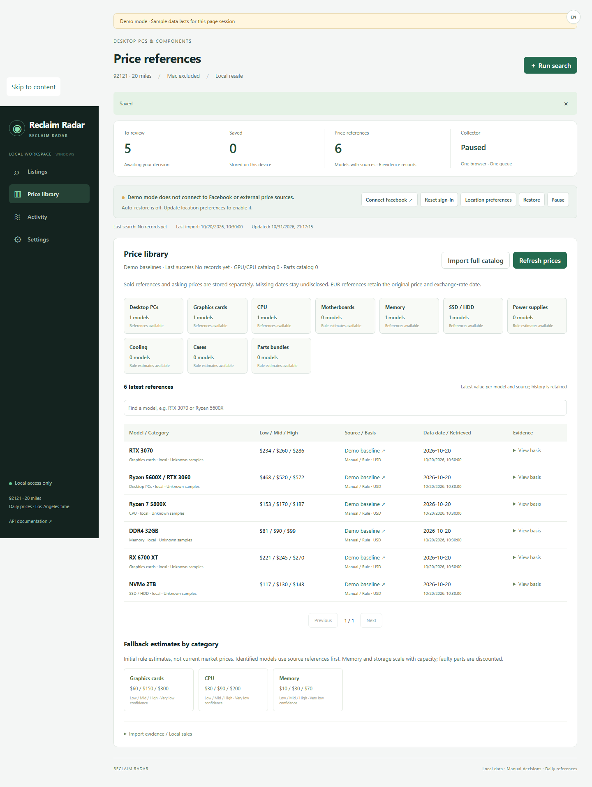
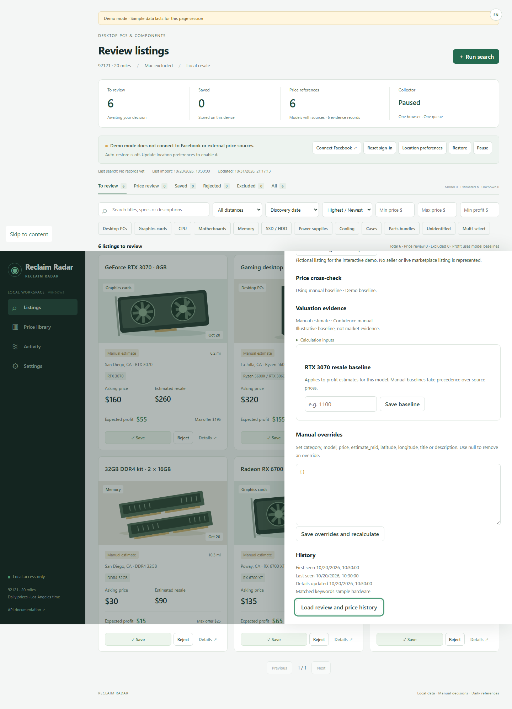
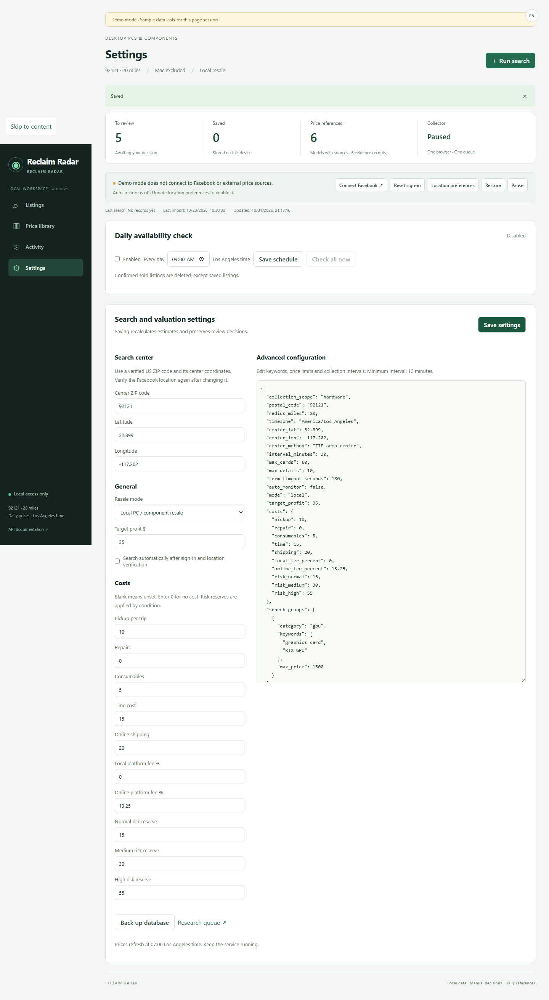
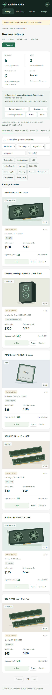
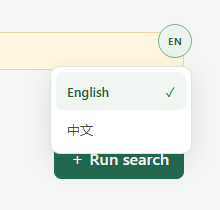
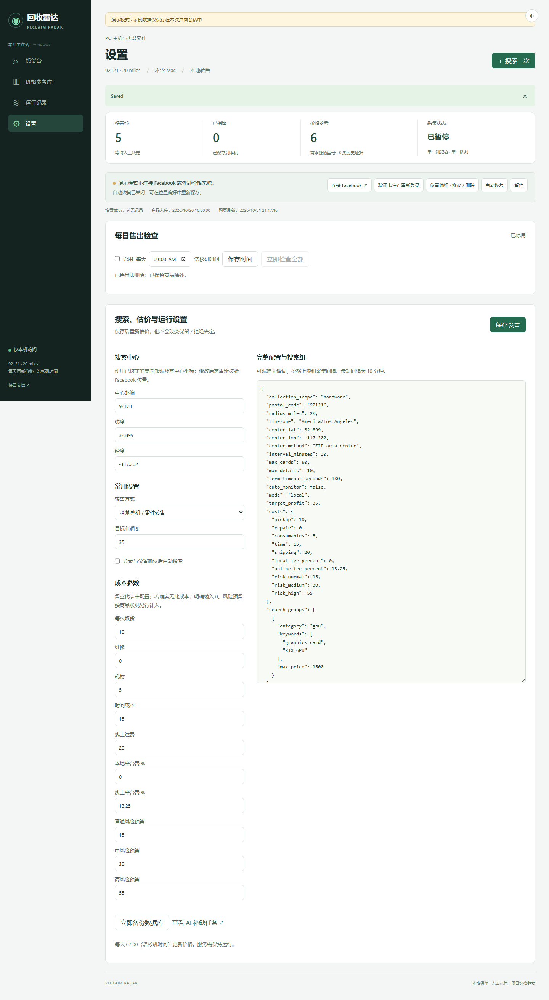
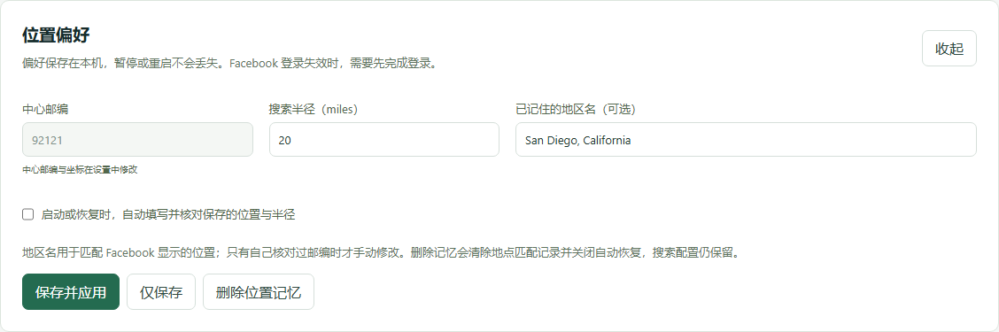

# 回收雷达 · Reclaim Radar

在本机查找 Facebook Marketplace 上的二手 PC 主机与内部零件，比较转售估价、查看来源证据，再由你决定保留或拒绝。基于 React、TypeScript、FastAPI 和 SQLite，提供可即时切换的中英文界面。

[English](README.md) | **简体中文**

软件在 Windows 本地运行，通过项目专用浏览器登录 Facebook。不会自动联系卖家、出价或购买。



*截图使用虚构演示商品和示意价格，不代表真实在售商品或已核实成交；硬件插画随源码提供。*

## 目录

- [主要功能](#主要功能)
- [Windows 安装与部署](#快速开始windows)
- [先体验演示](#先体验界面)
- [切换界面语言](#切换界面语言)
- [选择搜索地区](#选择搜索地区)
- [搜索与审核商品](#搜索与审核商品)
- [估价与每日任务](#估价与每日任务)
- [数据、备份和故障处理](#数据与适用范围)
- [开发与验证](#开发与验证)
- [发布到 GitHub](#发布到-github)

## 主要功能

- **找货与审核：** 整机、显卡、CPU、主板、内存、存储、电源、散热、机箱与零件包；排除 Mac 和无关商品。
- **估价与利润：** 比较标价、转售基准、预计利润、成本、风险预留与建议最高出价。
- **证据与待核价：** 保留来源链接、日期、置信度及价格口径；依据不足的商品进入“待核价”。
- **持久保存决定：** 保留、拒绝与恢复待审核写入本地 SQLite，刷新或重启后仍保留。
- **位置与运行管理：** 设置美国邮编、中心坐标、半径、关键词与价格上限；恢复位置，查看运行记录和每日任务。
- **双语与窄屏适配：** 默认英文，右上角小圆形按钮切换语言并记住手动选择；支持键盘操作和手机尺寸布局。

## 快速开始（Windows）

准备 Windows 10/11、加入 PATH 的 [Python 3.13+](https://www.python.org/downloads/windows/)、包含 npm 的 [Node.js 22.12+](https://nodejs.org/en/download)，以及 Chrome 或 Edge。真实采集需要可使用 Marketplace 的 Facebook 账号。安装和外部数据获取需要联网。

1. 在 GitHub 点击 **Code → Download ZIP**，或克隆仓库。先解压到可写文件夹。
2. 双击 **Install.cmd**，安装锁定依赖并构建网页。无需管理员权限、WSL 或 Docker。
3. 双击 **Start.cmd**，打开 **[http://127.0.0.1:8765](http://127.0.0.1:8765)**。
4. 首次打开默认为英文，点击右上角小圆形 **EN** 按钮，再选择 **中文**。“设置”中填写美国邮编、对应中心经纬度、目标利润和实际成本。初始示例为 **92121 / 20 miles**；改变邮编时必须更新坐标。坐标需自行核实，软件不自动查询邮编坐标。
5. 点击“连接 Facebook”，在专用浏览器中完成登录和验证，再点“自动恢复”应用并核对位置。半径和地区名可在“位置偏好”修改。
6. 运行一个关键词搜索并审核结果。开启自动搜索后，登录与位置确认完成即可按搜索组采集。

双击 **Stop.cmd** 停止。可选用 **EnableStartup.cmd** 开启 Windows 登录后启动，**DisableStartup.cmd** 关闭。安装不会自动启用开机启动。

升级已有安装时：先停止，备份并保留 `.data/`，替换源码，重新运行 **Install.cmd** 和 **Start.cmd**。后端更新需重启服务，仅刷新网页不会加载后端修改。

成本留空代表未配置，暂按零计算；确实没有该成本时请填写 `0`。金额为美元，距离为英里。计划任务固定使用 `America/Los_Angeles` 时区，自动处理夏令时。

### 详细安装步骤

**第一步：确认依赖。** 打开 PowerShell：

```powershell
python --version
node --version
npm --version
```

Python 需为 3.13 或更新版本，Node 需为 22.12 或更新版本。找不到命令时，安装对应工具并重新打开终端。Python 安装时要勾选加入 PATH。

**第二步：解压项目。** 例如解压到 `C:\Tools\reclaim-radar`。不要在 ZIP 预览窗口里运行脚本，也不要只移动启动文件。根目录应同时保留 `radar`、`frontend`、`scripts` 等文件夹。

**第三步：运行安装。** 双击 `Install.cmd`，也可以在 PowerShell 中执行，以便查看完整输出：

```powershell
Set-Location 'C:\Tools\reclaim-radar'
.\Install.cmd
```

脚本依次创建 `.venv`、安装 Python 锁定依赖、执行 `npm ci`、构建 `frontend/dist`。看到 **Installation complete** 才表示完成。首次需要联网，依赖保存在项目目录内。

**第四步：启动。** 双击 `Start.cmd`，服务在后台运行并打开网页。若提示已运行，会复用该实例。执行计划任务期间需保持电脑开机和唤醒。

**第五步：首次配置。** 设置地区与成本，连接 Facebook、恢复位置，再运行一次搜索。新数据库没有商品是正常情况；README 里的演示数据不会导入真实工作区。

### 选择运行方式

| 方式 | 启动方法 | 地址 | 用途 |
| --- | --- | --- | --- |
| 正常应用 | Install.cmd 后运行 Start.cmd | http://127.0.0.1:8765 | 真实采集、持久审核、备份 |
| 独立演示 | Demo.cmd | http://127.0.0.1:5173/?demo=1 | 无需 Facebook 账号体验 |
| 前端开发 | 后端运行时，在 frontend 执行 npm run dev | http://127.0.0.1:5173 | 修改网页并即时预览 |

部署目标是 Windows 桌面，正常使用不需要域名、反向代理或云服务器。GitHub 用于分享源码。静态托管只能展示前端演示，无法提供真实采集、SQLite 数据持久化或登录浏览器。

### 停止、重启与开机启动

- 运行 **Stop.cmd** 停止。只关闭网页标签不会停止后台服务。
- 重启时，等待 Stop.cmd 完成，再运行 **Start.cmd**。
- 手动配置成功后，可选运行 **EnableStartup.cmd**，在当前用户登录 Windows 的交互式桌面会话中自动启动。
- **DisableStartup.cmd** 取消启动任务；已经运行的服务需另用 Stop.cmd 停止。
- 更新源码后运行 Install.cmd 重新构建并重启。保留 `.data` 可保留设置与审核记录。

## 先体验界面

双击 **Demo.cmd**，只需 Node.js。第一次安装前端依赖，按 **Ctrl+C** 停止演示服务器。也可运行：

```powershell
cd frontend
npm ci
npm run demo
```

演示页面使用 `?demo=1`，不连接 Facebook 或真实数据库。筛选、保留／拒绝、语言切换和设置可在内存中体验；刷新重置演示数据，语言选择保留。真实采集、价格导入、备份等外部操作在演示中不可用，请求不会转发到后端。



<details>
<summary>查看价格库、详情、设置与手机布局</summary>







</details>

## 切换界面语言

首次使用默认为 **English**，即使 Windows 或浏览器设置为中文。本次升级也采用新的英文默认偏好，不再沿用旧版自动识别出的语言。

1. 点击右上角的小圆形 **EN** 按钮。
2. 展开菜单后选择 **English** 或 **中文**。
3. 菜单收起，界面立即切换；中文状态下圆形按钮显示 **中**。
4. 手动选择保存在当前浏览器和访问地址下，刷新后保留。其他浏览器或地址各自保存。

只有点击按钮才显示选项。键盘用户可以聚焦按钮，按 Enter 或向下箭头打开，用方向键选择并按 Enter，Esc 关闭。应用语言不影响 Facebook 自己的语言，也不会翻译卖家原文。



## 选择搜索地区

地区有两部分：**计算距离使用的中心邮编与坐标**，以及 **Facebook 实际搜索的位置与半径**。真实采集前需要两者一致。

### 1. 填写邮编与中心坐标

打开 **设置 → 搜索中心**，英文对应 **Settings → Search center**。

| 字段 | 应填写的内容 | 初始示例 |
| --- | --- | --- |
| 中心邮编 / Center ZIP code | 5 位美国邮编，保留开头的零 | `92121` |
| 纬度 / Latitude | 邮编范围内近似点的南北坐标 | `32.899` |
| 经度 / Longitude | 东西坐标，美国大部分地区为负数 | `-117.202` |

在可信地图或坐标来源中，找出该邮编范围内的近似公共地点，按 **纬度、经度** 的顺序填写。不要填反，也不要漏掉西经的负号。不需要提供自家精确地址。

替换成你核实过的数据后，点击设置面板上方 **保存设置 / Save settings**。只改邮编、保留旧坐标会被拒绝。改变地区会清除旧位置核验，但不会删除人工保留／拒绝决定。



*截图来自演示模式，正常使用请在真实应用中填写自己的地区。*

### 2. 设置搜索半径

回到 **找货台 / Listings**，在连接控制区打开 **位置偏好 · 修改 / 删除 / Location preferences**。

- **搜索半径：** 1–100 的整数，单位英里。先选择自己愿意取货的范围；Facebook 可能只提供部分半径值。
- **已记住的地区名：** 一般留空，让程序根据邮编自动选地点。手动填写时，应使用自己在 Facebook 核对过邮编的地区名；不能把某个卖家的城市当成搜索中心。
- **自动恢复位置与半径：** 想在启动或恢复监控时套用保存位置，就勾选。

此处邮编只读，需回设置页与坐标一起修改。



### 3. 登录并应用位置

1. 点击 **连接 Facebook / Connect Facebook**，在项目专用浏览器登录。
2. Facebook 要求验证时由你本人完成，再进入 Marketplace。
3. 回到雷达，点击位置偏好中的 **保存并应用 / Save and apply**；已经保存也可点 **自动恢复 / Restore**。
4. 程序尝试选择邮编建议项与半径，应用后再次检查页面上的搜索位置控件。
5. 状态显示 **监控就绪 / Ready** 后再搜索。若仍待核验位置，检查 Facebook 实际地区和半径，修改偏好后重试。

**仅保存** 只写入本地，不立即应用到 Facebook。**删除位置记忆** 会移除地点匹配、关闭自动恢复并暂停采集，但保留中心与半径配置。**验证卡住？重新登录** 创建新的登录配置，需要重新登录；适用于登录异常，不必每次换地区都使用。

### 4. 看懂距离标记

| 标记 | 含义 | 应如何处理 |
| --- | --- | --- |
| 基于坐标的距离 | 配置中心至商品坐标的直线距离 | 核实实际取货路线，并非驾车里程 |
| 约／待核实 | 使用城市代表点粗估 | 核实卖家实际区域 |
| 范围待确认 | 缺少可靠地点或坐标 | 其他条件合适时留待人工核验 |
| 确认范围外 | 可靠坐标显示超出半径 | 需要时查看系统排除 |

离线城市名称库目前只覆盖 California、Nevada、Arizona。可配置美国其他地区的邮编与坐标，但商品没有坐标时可能仍显示范围待确认。软件不自动下载全国邮编坐标库。

## 搜索与审核商品

### 完成第一次搜索

1. 在设置里选择 **本地整机／零件转售** 或 **线上拆件转售**。
2. 填好取货、维修、耗材和时间成本；线上转售还需核对运费与平台费，设置目标利润并保存。
3. 确认 Facebook 已连接，采集状态为监控就绪。
4. **搜索一次** 使用当前关键词。全新空列表中，可在关键词输入框填写内容，再点 **运行这个关键词 →**。
5. 查看采集状态和运行记录，页面会定期刷新结果。

列表上方的 **搜索标题、配置或描述** 只筛选已入库商品，不会启动新的 Facebook 搜索。若要修改轮询关键词，在 **设置 → 完整配置与搜索组** 编辑 `search_groups`，保留其他字段：

```json
{
"search_groups": [
  {
    "category": "gpu",
    "keywords": ["graphics card", "RTX GPU"],
    "max_price": 300
  },
  {
    "category": "pc",
    "keywords": ["gaming PC", "desktop computer"],
    "max_price": 700
  }
]
}
```

这里只展示完整配置中的一个字段，不能用它替换整个 JSON 文档。采集间隔最短 10 分钟；只想手动使用时可关闭自动搜索。**暂停** 会暂停采集，保留位置偏好。

### 审核列表与筛选

| 标签 | 内容 |
| --- | --- |
| 待审核 / To review | 筛选后的待决定候选 |
| 待核价 / Price review | 目标硬件，但价格依据仍需核对 |
| 已保留 / Saved | 你主动保留的商品 |
| 已拒绝 / Rejected | 你主动拒绝的商品 |
| 系统排除 / Excluded | 无关、超范围或依据可靠但利润不足等记录 |
| 全部记录 / All | 各组中仍保留的全部记录 |

可按标题／配置、距离、排序、价格、利润与品类筛选。品类默认单选，开启 **多选** 可选择多个。空结果时 **清除筛选** 重置筛选值；若要换审核队列，仍需点击对应标签。

### 看详情并作决定

1. 比较卖家标价、估计转售价、预计利润和最高出价。
2. 打开 **详情**，查看卖家描述、配置、风险、距离依据和价格证据。
3. **打开原商品** 可检查实际页面，再决定如何联系卖家。演示商品为虚构数据，原商品链接不可用。
4. 点击 **保留** 或 **拒绝**，真实模式会持久保存。详情里的 **恢复待审核** 可重新打开决定。
5. 识别型号或价格有误时，按详情说明填写人工修正字段，保存并重新估价；填 `null` 可撤销该字段的修正。

人工型号基准会影响同型号其他商品的估价。只填写自己打算采用的基准，手工输入不会自动成为已核实市场成交。


### 使用价格参考库

搜索型号或选择品类后，展开 **查看口径** 阅读来源说明。**更新价格库** 刷新可用证据，**全目录建库／补抓** 是更大范围的目录任务；失败或排队情况查看运行记录。

导入证据或记录实际成交时，展开导入区，按照本地 API 的 Evidence／Sale 格式填写。保留来源链接、日期、市场和价格口径，不要把在售价标成已完成成交价。

## 估价与每日任务

估价依次参考人工型号基准、型号证据、同代同规格参考、类别参考与初始规则粗估。**规则表不是实时市场价。** 内存与存储按容量调整，整机与拆件价值不会重复相加。

```text
预计利润 = 转售基准 × (1 − 渠道费率)
           − 取货／维修／耗材／时间／适用运费
           − 风险预留 − 卖家标价

建议最高出价 = max(0, 净回收值 − 目标利润)
```

来源包括 Second Hand Silicon、PCPrice.watch、Get PC Parts、可访问时的 eBay 公开已售搜索，以及用户输入的证据。来源可能缺项、过时或受限；成交参考、在售价、人工基准分开保存。同一上游市场的多个网站不算独立交叉验证，估值不保证转售收益。

服务运行时每天 **07:00 洛杉矶时间** 更新价格；售出检查默认 **09:00**，可停用或改时间。错过时间会在启动后尝试补做。**明确已售出的商品会删除，已经人工保留的除外。** 保留商品标记已售出；打不开、消失、Pending 或登录验证不会直接当作售出。既有轮换备份保留。

`/api/research` 提供可选的外部研究队列。本仓库**不会安装 Codex 账号、AI 订阅或每天 08:00 的 AI 自动任务**，基础功能不需要 AI API Key。

## 数据与适用范围

数据库、登录会话、日志、截图和备份在 `.data/`，已被 Git 和发布打包排除。升级时保留该目录；不要上传到 GitHub 或问题反馈。语言偏好在浏览器本地存储。

- 只监听 `127.0.0.1:8765`，拒绝跨站写入。这是 Windows 本地应用，不是公网多用户服务。GitHub 可托管源码，GitHub Pages 无法运行 Python 后端和登录浏览器。
- 采集依赖 Facebook 页面、账号权限和位置设置。登录及验证码由用户完成，搜索不保证覆盖所有商品。自动测试不代表其他账号或邮编的真实采集已验证。
- 支持设置美国邮编和匹配坐标。离线城市名称库目前只覆盖 **California、Nevada、Arizona**；其他地区缺少商品坐标时显示范围待确认。城市代表点无法确认卖家的实际距离。
- 控件与常见诊断提供双语；卖家原文、来源证据、原始 JSON 字段和无法识别的外部错误保留原文。
- 本地启动与真实采集仅支持 Windows。前端演示可用 Node.js 在其他系统运行，但没有 macOS/Linux 真实采集支持。

每日备份在 `.data/backups/`，保留最近 14 份。先停止服务，再恢复：

```powershell
.\Stop.cmd
.\scripts\Restore.ps1 -BackupPath 'C:\备份目录\backup.sqlite3'
.\Start.cmd
```

恢复前验证备份并保存现有数据库。不要直接复制正在写入的 SQLite 文件。详见 [安全与隐私](SECURITY.md)。

| 问题 | 处理 |
| --- | --- |
| 找不到 python / npm | 安装工具、重开终端，再运行 Install.cmd。 |
| 8765 或演示端口 5173 被占用 | 停止占用端口的应用；脚本不结束无关进程。 |
| Facebook 要求登录 | 在专用浏览器完成后点击自动恢复。 |
| 验证卡住 | 使用“验证卡住？重新登录”创建新配置，重新登录。 |
| 位置不匹配 | 核对邮编、坐标、地区名和半径，再恢复。 |
| 价格来源失败 | 查看运行记录；旧证据和标注的粗估保留。 |
| 无匹配商品 | 清除筛选，查看待核价／系统排除／全部记录。 |
| 启动失败 | 查看 .data/logs/server.stderr.log，运行 SelfTest.cmd。 |

## 开发与验证

```powershell
.\Install.cmd
.\SelfTest.cmd

# 后端：先停止已有实例
.\.venv\Scripts\python.exe -m radar

# 第二个终端运行前端
cd frontend
npm run dev
```

Vite 在 `127.0.0.1:5173` 运行，把 `/api` 代理至 8765。正常使用时 FastAPI 直接提供构建网页，无需单独启动 Vite。[本地接口文档](http://127.0.0.1:8765/docs)提供参数格式。`config.example.json` 是格式示例；实际配置保存在 SQLite，通过设置页或 API 修改。

```powershell
# 浏览器回归与截图，不使用真实账号
.\.venv\Scripts\python.exe -m playwright install chromium
.\.venv\Scripts\python.exe scripts/ui_smoke.py

# 构建后重新生成文档截图
.\.venv\Scripts\python.exe scripts/ui_smoke.py --screenshots docs/screenshots

# 制作源码分享包
python scripts/package_release.py
```

生成 `release/reclaim-radar-0.2.0-source.zip`，包含源码、锁文件、脚本、文档、截图与许可证；不包含 Python、Node、依赖和私人数据。接收者按快速开始安装。GitHub Actions 提供 Windows 后端测试、翻译检查、生产构建与浏览器检查。见 [验收范围](ACCEPTANCE.md)、[贡献说明](CONTRIBUTING.md)、[更新记录](CHANGELOG.md)。

目录：`radar/` 后端，`frontend/` 网页与翻译，`scripts/` 安装与打包，`tests/` 测试，`docs/screenshots/` 演示截图，`third_party/` 上游出处。

## 发布到 GitHub

从项目根目录上传源码，GitHub 会默认展示英文 `README.md`。英文顶部 **简体中文** 打开 `README.zh-CN.md`，中文顶部 **English** 返回英文。普通 Markdown 链接即可切换，不依赖脚本或另行部署网站。

上传前查看 `git status`，不要提交 `.data/`、`.venv/`、`node_modules/`、`.env` 和本地测试产物；这些路径已被忽略。保留锁文件、截图、LICENSE 与上游署名，不要强制添加运行数据。

执行 `python scripts/package_release.py` 可生成源码包，直接分享或附加到 GitHub Release。接收者解压后按 Windows 安装流程使用。这不是无需环境的独立 EXE，项目文件没有假定仓库地址或上线域名。

## 许可证与署名

[AGPL-3.0](LICENSE)。卡片解析适配自 [BoPeng/ai-marketplace-monitor](https://github.com/BoPeng/ai-marketplace-monitor)，固定源码和许可证在 [third_party/aimm](third_party/aimm/UPSTREAM.txt)。GeoNames 数据使用 CC BY 4.0，详见 [数据署名](radar/data/README.md)。项目与 Facebook、Meta 和价格来源网站没有隶属关系。

